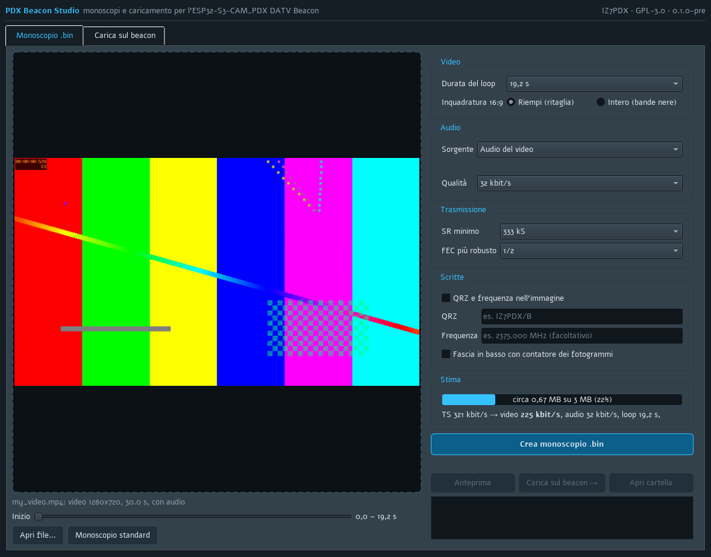
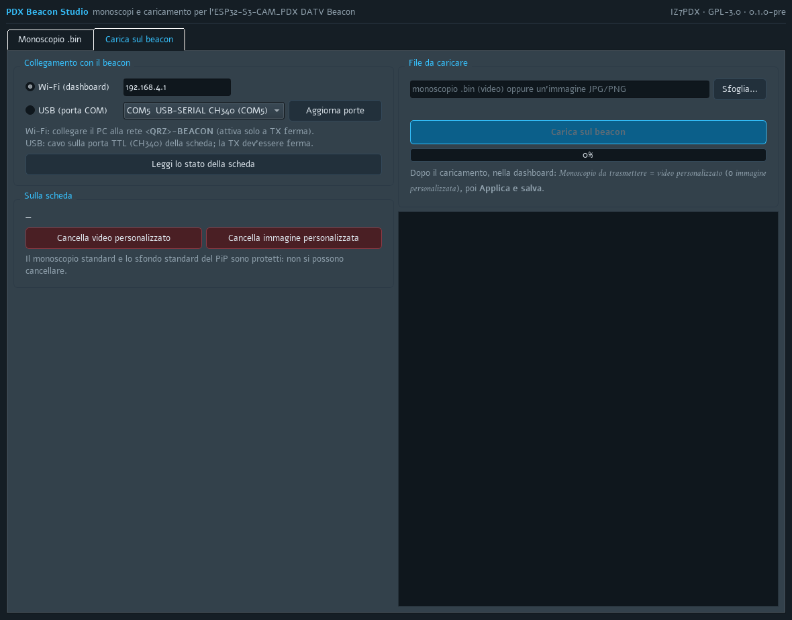

# PDX Beacon Studio

**Pre-release 0.1.0** · Windows app for the [ESP32-S3-CAM_PDX DATV Beacon](https://github.com/Photoluis/Esp32s3-cam-pdx-datv-beacon)
· by IZ7PDX · GPL-3.0 · [Italiano](README_it.md)

Turn any video or picture into a monoscope `.bin` for the beacon and upload it, without the command line.

> The user interface is in **Italian** for now; English will follow. This is a pre-release: please report
> problems in the Issues.



## What it does

**Monoscopio .bin** (monoscope)
- drop a video (MP4, MOV, MKV, AVI…) or a picture (JPG, PNG…) and see the frame as it will go on air;
- choose the start point, the loop length (19.2 s × 1–5) and the 16:9 framing (fill by cropping, or whole with
  black bars);
- audio: 1 kHz tone, the video's own audio or an audio file, 32–64 kbit/s;
- the lowest SR and most robust FEC you will transmit with: the video bitrate is computed from them;
- optional callsign / frequency text and a band with the frame counter;
- live, conservative estimate of the size against the 3 MB of the custom area;
- **Preview** rebuilds the `.bin` into an MP4: exactly what the beacon will transmit.

**Carica sul beacon** (upload)
- over **Wi-Fi** (PC joined to `<CALL>-BEACON`, dashboard at 192.168.4.1) or **USB** (the board's COM port);
- shows what is on the board, uploads the custom video or the custom picture (JPG/PNG are converted to 320x180),
  erases the custom files;
- before replacing or erasing, it reads the board and **names the file that will be lost**;
- the beacon must not be transmitting. USB is slow (about 5 KB/s: ~6 minutes for 2 MB); Wi-Fi is faster.



## Download and run

1. Download `PDX_Beacon_Studio_v0.1.0-pre_Windows.zip` from the [Releases](../../releases).
2. Unzip it anywhere and run `PDX_Beacon_Studio.exe`. ffmpeg is included; nothing else to install.

Windows may warn that the app is from an unknown publisher (it is not code-signed): *More info → Run anyway*.

## Run from source

```
cd tools
python -m venv .venv
.venv\Scripts\python -m pip install -r ..\requirements.txt
.venv\Scripts\python studio\pdx_studio.py
```

ffmpeg with libx265 is needed on the PATH (e.g. `winget install Gyan.FFmpeg`).
Core test without a board: `.venv\Scripts\python studio\test_studio_core.py`.
Build the package: `powershell -ExecutionPolicy Bypass -File build_exe.ps1`.

## Files

- `tools/studio/` — the app (`pdx_studio.py` interface, `studio_core.py` logic, test);
- `tools/make_es.py`, `make_bg.py`, `make_symbols.py`, `tools/dvbs2/` — copied unchanged from the beacon
  repository (monoscope encoder, picture format, DVB-S2 rate tables).

## Licence

GPL-3.0 (see `LICENSE`). Third-party components in the package: see [THIRD_PARTY.md](THIRD_PARTY.md).
Contact: iz7pdx@gmail.com
