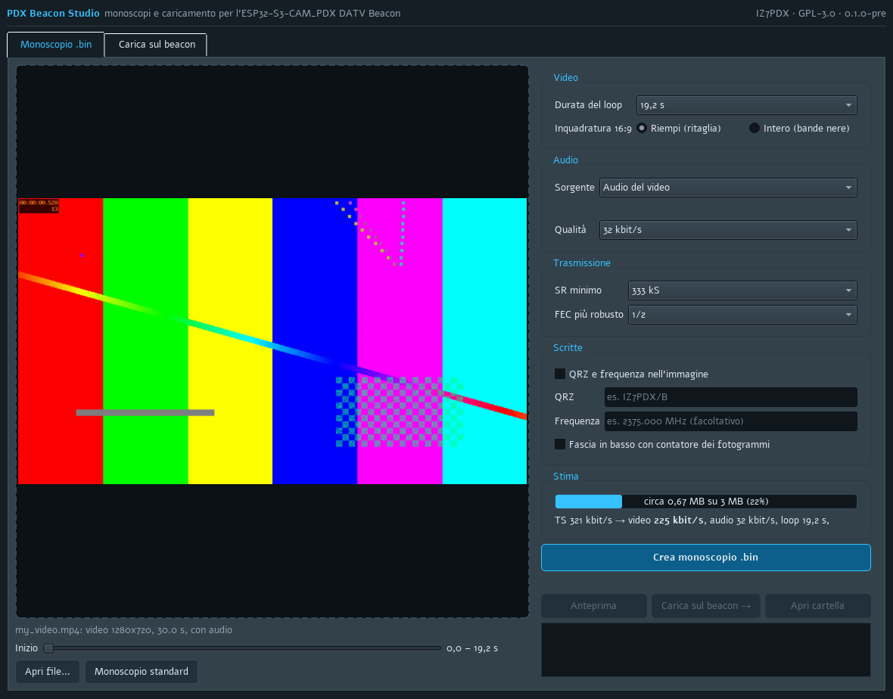
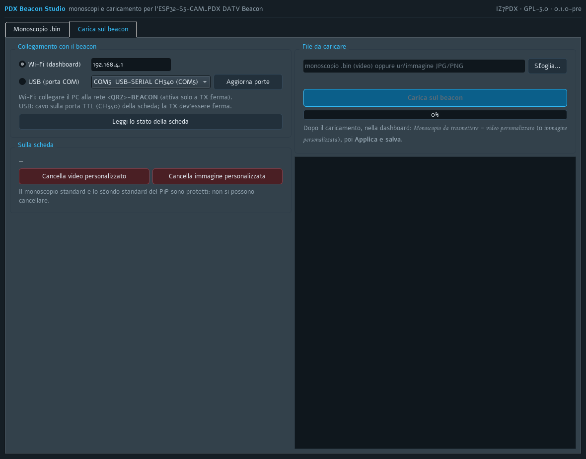

# PDX Beacon Studio

**Pre-release 0.1.0** · App per Windows per l'[ESP32-S3-CAM_PDX DATV Beacon](https://github.com/Photoluis/Esp32s3-cam-pdx-datv-beacon)
· di IZ7PDX · GPL-3.0 · [English](README.md)

Trasforma qualsiasi video o immagine in un monoscopio `.bin` per il beacon e lo carica sulla scheda, senza riga di
comando.

> È una pre-release: segnalate i problemi nelle Issues.



## Cosa fa

**Monoscopio .bin**
- si trascina un video (MP4, MOV, MKV, AVI…) o un'immagine (JPG, PNG…) e si vede il fotogramma come andrà in aria;
- si scelgono il punto di inizio, la durata del loop (19,2 s × 1–5) e l'inquadratura 16:9 (riempi ritagliando oppure
  intero con bande nere);
- audio: tono da 1 kHz, audio del video o file audio, 32–64 kbit/s;
- SR minimo e FEC più robusto con cui si trasmetterà: da questi dipende il bitrate del video;
- scritte QRZ / frequenza e fascia con il contatore dei fotogrammi, facoltative;
- stima prudente della dimensione rispetto ai 3 MB dell'area personalizzata, aggiornata mentre si cambia;
- **Anteprima**: il `.bin` ricostruito in MP4, cioè esattamente ciò che il beacon trasmetterà.

**Carica sul beacon**
- via **Wi-Fi** (PC collegato a `<QRZ>-BEACON`, dashboard su 192.168.4.1) o via **USB** (porta COM della scheda);
- mostra i file presenti, carica il video personalizzato o l'immagine personalizzata (JPG/PNG convertite da sole a
  320x180), cancella i file personalizzati;
- prima di sostituire o cancellare legge la scheda e **dice il nome del file che andrà perso**;
- la TX dev'essere ferma. La USB è lenta (circa 5 KB/s: ~6 minuti per 2 MB); il Wi-Fi è più veloce.



## Scaricare e avviare

1. Scaricare `PDX_Beacon_Studio_v0.1.0-pre_Windows.zip` dalle [Release](../../releases).
2. Scompattarlo dove si vuole e avviare `PDX_Beacon_Studio.exe`. ffmpeg è incluso: non serve installare altro.

Windows può avvisare che l'editore è sconosciuto (l'app non è firmata): *Ulteriori informazioni → Esegui comunque*.

## Avvio dai sorgenti

```
cd tools
python -m venv .venv
.venv\Scripts\python -m pip install -r ..\requirements.txt
.venv\Scripts\python studio\pdx_studio.py
```

Serve ffmpeg con libx265 nel PATH (es. `winget install Gyan.FFmpeg`).
Prova del nucleo senza scheda: `.venv\Scripts\python studio\test_studio_core.py`.
Pacchetto: `powershell -ExecutionPolicy Bypass -File build_exe.ps1`.

## File

- `tools/studio/`: l'app (`pdx_studio.py` interfaccia, `studio_core.py` logica, prova);
- `tools/make_es.py`, `make_bg.py`, `make_symbols.py`, `tools/dvbs2/`: copiati invariati dal repository del beacon
  (codifica del monoscopio, formato immagine, tabelle dei bitrate DVB-S2).

## Licenza

GPL-3.0 (vedi `LICENSE`). Componenti di terze parti nel pacchetto: [THIRD_PARTY.md](THIRD_PARTY.md).
Contatto: iz7pdx@gmail.com
